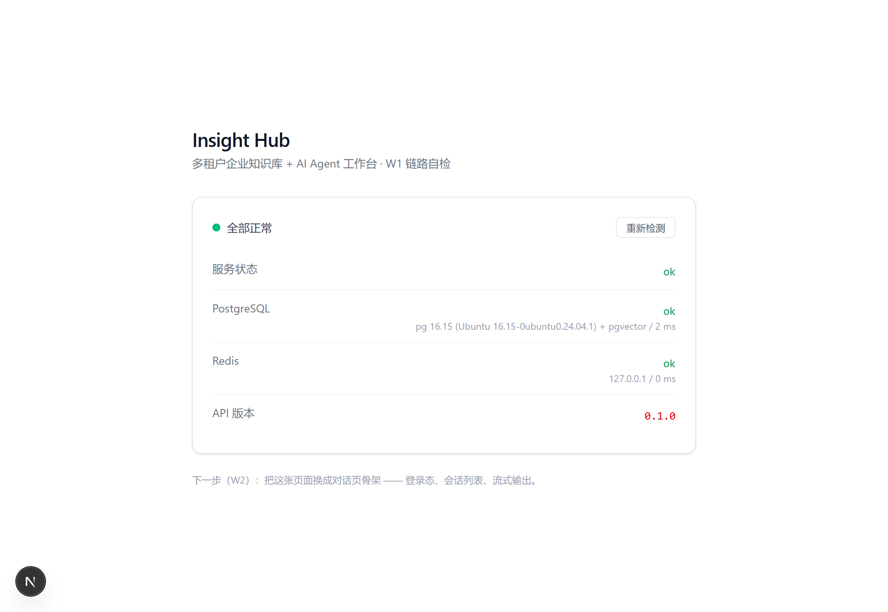

# Insight Hub

多租户企业知识库 + AI Agent 工作台。

> 企业把文档传上来，员工既能基于文档问答（答案带页码引用），也能让 Agent 调用内部工具完成多步任务。
> 当前进度：**W1 —— 全链路骨架跑通**（Web → API → PostgreSQL / Redis）。

---

## 技术栈

| 层 | 选型 | 选择理由 |
|---|---|---|
| 前端 | Next.js（App Router）+ TypeScript + Tailwind | 服务端组件减少往返，生态成熟 |
| 后端 | FastAPI + SQLAlchemy 2.0 | 与 AI 生态同栈；Pydantic 校验 + 自动生成 OpenAPI |
| 数据库 | PostgreSQL 16 + pgvector | 向量与业务同库，支持事务与元数据过滤，少运维一个组件 |
| 缓存 / 队列 | Redis 7 | 缓存、限流、后续的 Celery 队列 |
| 运行环境 | WSL2 + Ubuntu 24.04 | Win10 家庭版跑不了 Docker Desktop，改用 WSL 原生服务 |

> 详细的取舍记录见 [docs/tech-stack.md](docs/tech-stack.md)。

---

## 界面（W1）



<sub>W1 验收截图：Web → API → PostgreSQL（含 pgvector）/ Redis 全链路连通。更多见 [docs/screenshots/](docs/screenshots/)。</sub>

---

## 快速开始

**0. 启动数据库和缓存**（每次重启 Windows 后都要跑一次）

```powershell
wsl -d Ubuntu-24.04 -u root -- /usr/local/bin/start-services.sh
```

**1. 后端**（venv 和依赖已装好，通常只需最后一行）

```powershell
cd apps\api
uv venv --python 3.12 .venv          # 已做过
uv pip install -r requirements.txt   # 已做过
.\.venv\Scripts\python.exe -m uvicorn main:app --reload --port 8000
```

打开 http://127.0.0.1:8000/api/health ，期望：

```json
{"status":"ok","db":"ok","redis":"ok","version":"0.1.0"}
```

> 为什么不用 `uv run uvicorn`：`uv run` 需要 `pyproject.toml` 定义项目，本项目 W1 用的是
> `requirements.txt` 方式，所以直接调 venv 里的 python 最稳（也绕开了 PowerShell 的脚本执行策略问题）。

**2. 前端**（依赖已装好）

```powershell
cd apps\web
npm.cmd run dev
```

打开 http://localhost:3000 ，三项指标全绿即成功。

> 若报 `npm : 无法加载文件 ...\npm.ps1，因为在此系统上禁止运行脚本`，用 `npm.cmd` 即可（不改系统设置）。

---

## 一条命令启动（推荐）

```powershell
.\scripts\dev.ps1
```

自动起数据库 → 后端 → 前端 → 等就绪 → 打开浏览器。加 `-NoBrowser` 不弹浏览器，加 `-SkipServices` 跳过数据库检查。

> 详细步骤、数据库操作、故障速查见 **[docs/runbook.md](docs/runbook.md)**。

> **数据库会自动启动**：已配置 Windows 计划任务 `InsightHub-WSL-Services`，用户登录 10 秒后自动拉起
> WSL 里的 PostgreSQL 和 Redis，无需手动执行 `start-services.sh`。

---

## 目录结构

```
insight-hub/
├─ apps/
│  ├─ api/            # FastAPI 后端
│  │  ├─ main.py
│  │  └─ requirements.txt
│  └─ web/            # Next.js 前端
├─ docs/
│  ├─ prd.md          # 产品需求（1 页）
│  ├─ tech-stack.md   # 技术选型与理由
│  └─ goals.md        # 能力自评（每月更新）
├─ docker/            # W6 部署时使用
└─ .github/workflows/ # W6 CI
```

---

## 路线图

- [x] **W1** 环境 + 骨架 + 健康检查全链路
- [ ] **W6** MVP 上线（鉴权 + 文档上传 + 简单问答 + 公网访问）
- [ ] **W13** RAG 达标（混合检索 + 重排 + 引用 + 离线评测，recall@5 ≥ 0.85）
- [ ] **W17** Agent 可用（LangGraph + 工具调用 + 人工审批，任务成功率 ≥ 80%）
- [ ] **W20** 可扩展（压测 + 降级 + 成本看板）

---

## 本地环境备注

- PostgreSQL：`insight` / `insight`，库名 `insight`，已启用 pgvector 0.6.0
- Redis：`redis://127.0.0.1:6379/0`（本地开发无密码）
- WSL 发行版数据目录：`D:\wsl\Ubuntu-24.04`