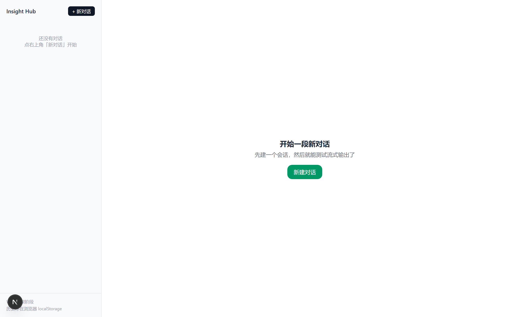

# Insight Hub

多租户企业知识库 + AI Agent 工作台。

> 企业把文档传上来，员工既能基于文档问答（答案带页码引用），也能让 Agent 调用内部工具完成多步任务。
> 当前进度：**W1 —— 全链路骨架跑通**（Web → API → PostgreSQL / Redis）。

---

## 技术栈

| 层 | 选型 | 选择理由 |
|---|---|---|
| 前端 | Next.js（App Router）+ TypeScript + Tailwind | 服务端组件减少往返，生态成熟 |
| 后端 | FastAPI + SQLAlchemy 2.0 | 与 AI 生态同栈；Pydantic 校验 + 自动生成 OpenAPI |
| 数据库 | PostgreSQL 16 + pgvector | 向量与业务同库，支持事务与元数据过滤，少运维一个组件 |
| 缓存 / 队列 | Redis 7 | 缓存、限流、后续的 Celery 队列 |
| 运行环境 | WSL2 + Ubuntu 24.04 | Win10 家庭版跑不了 Docker Desktop，改用 WSL 原生服务 |

> 详细的取舍记录见 [docs/tech-stack.md](docs/tech-stack.md)。

---

## 界面（W2）



<sub>W2：会话列表 + 消息区 + SSE 流式输出 + Markdown 渲染。设计记录见 [docs/w2.md](docs/w2.md)。</sub>

---

## 快速开始

**0. 启动数据库和缓存**（每次重启 Windows 后都要跑一次）

```powershell
wsl -d Ubuntu-24.04 -u root -- /usr/local/bin/start-services.sh
```

**1. 后端**（venv 和依赖已装好，通常只需最后一行）

```powershell
cd apps\api
uv venv --python 3.12 .venv          # 已做过
uv pip install -r requirements.txt   # 已做过
.\.venv\Scripts\python.exe -m uvicorn main:app --reload --port 8000
```

打开 http://127.0.0.1:8000/api/health ，期望：

```json
{"status":"ok","db":"ok","redis":"ok","version":"0.1.0"}
```

> 为什么不用 `uv run uvicorn`：`uv run` 需要 `pyproject.toml` 定义项目，本项目 W1 用的是
> `requirements.txt` 方式，所以直接调 venv 里的 python 最稳（也绕开了 PowerShell 的脚本执行策略问题）。

**2. 前端**（依赖已装好）

```powershell
cd apps\web
npm.cmd run dev
```

打开 http://localhost:3000 ，点「+ 新对话」发一条消息，看到**逐字流式出现**即成功。

> 若报 `npm : 无法加载文件 ...\npm.ps1，因为在此系统上禁止运行脚本`，用 `npm.cmd` 即可（不改系统设置）。

---

## 一条命令启动（推荐）

```powershell
.\scripts\dev.ps1
```

自动起数据库 → 后端 → 前端 → 等就绪 → 打开浏览器。加 `-NoBrowser` 不弹浏览器，加 `-SkipServices` 跳过数据库检查。

> 详细步骤、数据库操作、故障速查见 **[docs/runbook.md](docs/runbook.md)**。

> **数据库会自动启动**：已配置 Windows 计划任务 `InsightHub-WSL-Services`，用户登录 10 秒后自动拉起
> WSL 里的 PostgreSQL 和 Redis，无需手动执行 `start-services.sh`。

---

## 目录结构

```
insight-hub/
├─ apps/
│  ├─ api/                 # FastAPI 后端（W3 起分层）
│  │  ├─ main.py           # 只做装配：中间件 / 异常 / 路由
│  │  ├─ migrations/       # Alembic 迁移（建表与 RLS）
│  │  ├─ scripts/          # 造数与索引基准测试
│  │  └─ app/
│  │     ├─ core/          # config / security / errors / logging / deps
│  │     ├─ db/            # engine / session / Base
│  │     ├─ models/        # ORM（W4 扩展到 8 张表）
│  │     ├─ schemas/       # Pydantic 请求响应模型
│  │     ├─ repos/         # 数据访问
│  │     ├─ services/      # 业务逻辑
│  │     └─ routers/       # HTTP 接口
│  └─ web/                 # Next.js 前端
│     ├─ app/              # 路由页面（/ 与 /login）
│     ├─ components/       # Sidebar / ChatPanel / MessageItem / Composer
│     ├─ lib/              # api / auth / storage / types
│     └─ types/api.d.ts    # 由 OpenAPI 自动生成，勿手改
├─ docs/
│  ├─ prd.md               # 产品需求
│  ├─ tech-stack.md        # 技术选型与理由
│  ├─ errors.md            # 错误码表
│  ├─ schema.md            # 数据模型与设计决策
│  ├─ slow-queries.md      # 索引实验（10 组实测）
│  ├─ tenant-isolation.md  # 多租户 RLS 方案与验证
│  ├─ w2.md / w3.md        # 每周设计记录
│  └─ weekly/              # 周复盘
├─ scripts/                # dev.ps1 / dev.cmd / shot.ps1
├─ docker/                 # W6 部署时使用
└─ .github/workflows/      # W6 CI
```

---

## 路线图

- [x] **W1** 环境 + 骨架 + 健康检查全链路
- [x] **W2** 对话骨架与 SSE 流式输出
- [x] **W3** 后端分层 + 统一错误码 + JWT 鉴权 + OpenAPI 生成前端类型
- [x] **W4** 数据建模与索引（8 张表 + Alembic 迁移 + 多租户 RLS + 10 组索引实验）
- [ ] **W6** MVP 上线（鉴权 + 文档上传 + 简单问答 + 公网访问）
- [ ] **W13** RAG 达标（混合检索 + 重排 + 引用 + 离线评测，recall@5 ≥ 0.85）
- [ ] **W17** Agent 可用（LangGraph + 工具调用 + 人工审批，任务成功率 ≥ 80%）
- [ ] **W20** 可扩展（压测 + 降级 + 成本看板）

---

## 当前限制（截至 W4）

这些不是 bug，是**明确排期中的欠账**，写在这里避免误解：

| 限制 | 现状 | 什么时候解决 |
|---|---|---|
| 会话与消息存在浏览器 localStorage | 按 `userId` 隔离（换账号看不到彼此），但**不跨设备、多标签可能覆盖** | W5 落库到 `conversation`/`message` 表 |
| 对话回复是**占位内容** | 后端 `mock_answer()` 生成固定 Markdown，不调用任何模型 | W9 接真实模型（外部 API 或本地 vLLM） |
| 文档上传/解析未实现 | 表结构已就绪，接口没写 | W5（异步入库管道） |
| 没有 RAG 检索 | `chunk.embedding` 与 `tsv` 列已建，还没写入与检索 | W10–W13 |
| 没有 Agent | `agent_run` 表已建 | W14–W17 |

> **不训练模型**：本项目走「调用外部大模型 API + 自研 RAG/Agent 编排」，
> 可选本地部署 vLLM 做推理实验。理由见 [docs/tech-stack.md](docs/tech-stack.md)。

---

## 本地环境备注

- PostgreSQL：`insight` / `insight`，库名 `insight`，已启用 pgvector 0.6.0
- Redis：`redis://127.0.0.1:6379/0`（本地开发无密码）
- WSL 发行版数据目录：`D:\wsl\Ubuntu-24.04`